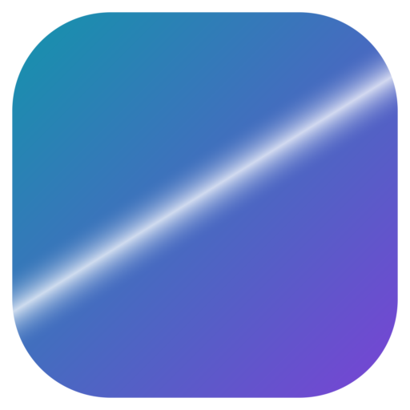
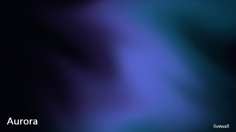
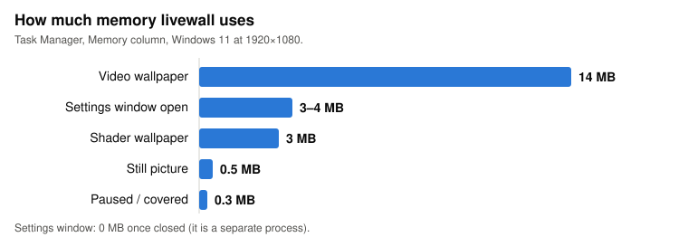
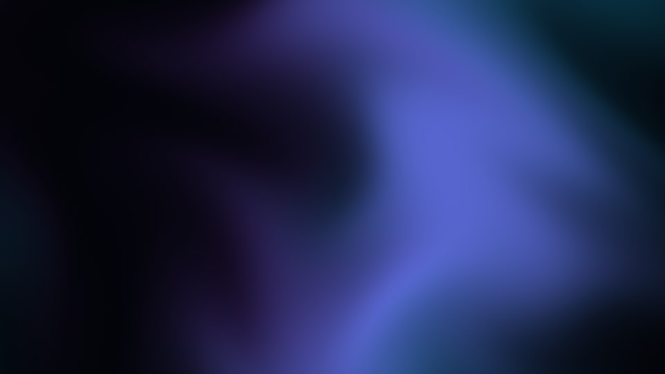
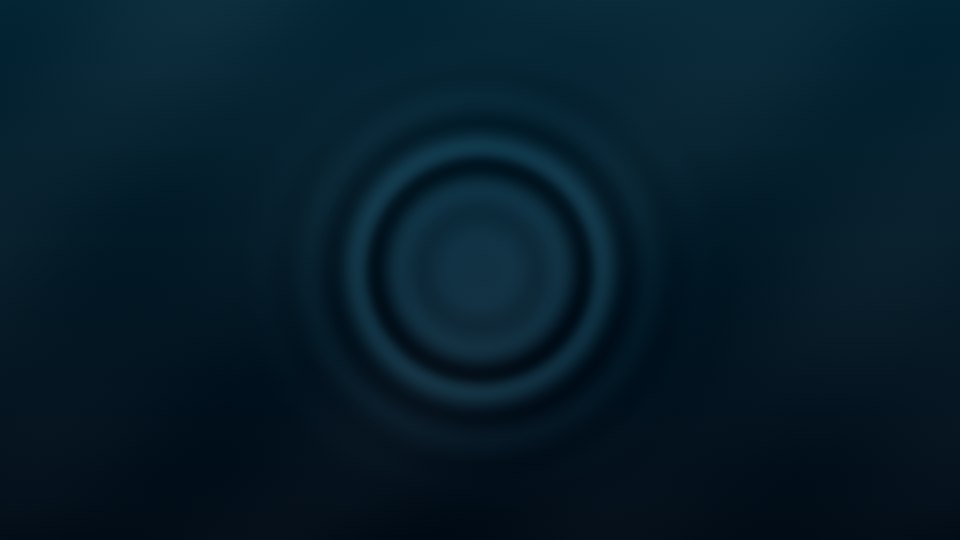
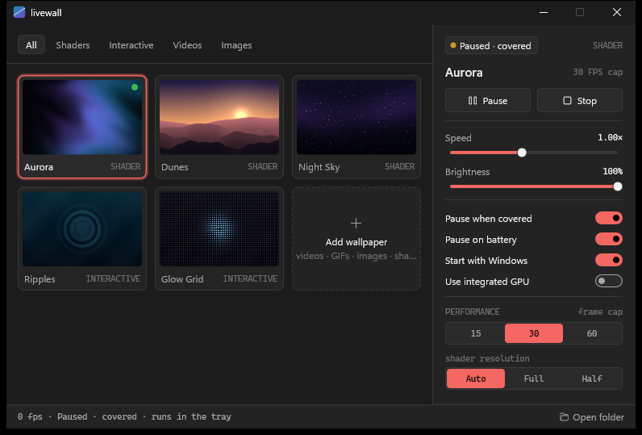
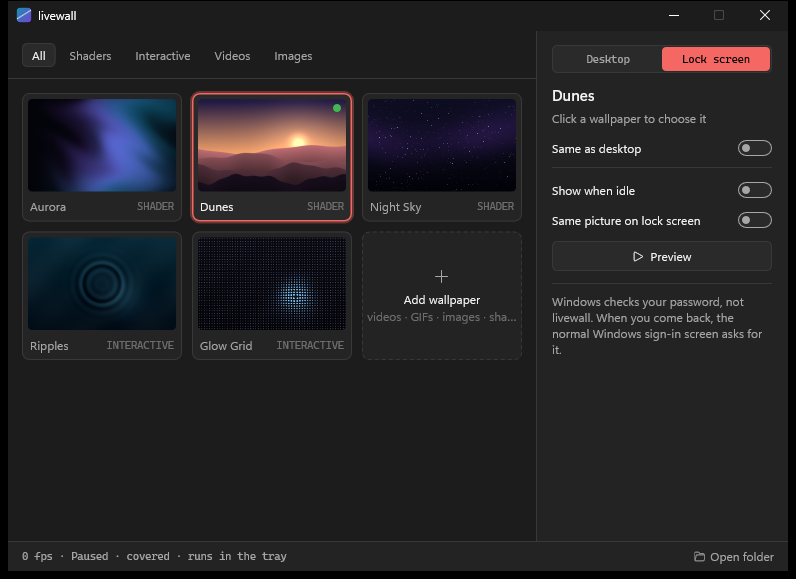

<p align="center"></p>

<h1 align="center">livewall</h1>

<p align="center">
  <b>Free, open-source live wallpaper for Windows 10, 11 and Linux.</b><br>
  Animated, video, GIF and picture wallpapers behind your desktop icons, using about <b>3 MB</b> of memory.
</p>

<p align="center">
  <a href="https://github.com/manndevani/LiveWallpaper/releases/latest"></a>
  
  
  
  <a href="LICENSE"></a>
</p>

<p align="center"><br><sub>The five built-in wallpapers, shown at 2× speed.</sub></p>

## Why livewall

| The numbers | What they mean |
|---|---|
| 🪶 **148 KB** | The whole app is one small file. Nothing to install, nothing extra to download, no account. |
| 🧠 **~3 MB** | Memory while an animated wallpaper is playing. |
| 💤 **0% GPU** | When a window covers the desktop, it stops completely and uses no graphics power. |
| ⚡ **~0.1% CPU** | Barely touches your processor. The graphics card does the work. |
| 🖥️ **Sharp** | Draws at your screen's own resolution. |
| 🆓 **Free forever** | MIT-licensed, no ads, no tracking, no account. |

<p align="center"></p>

## Wallpapers

Five animated wallpapers come built in, and they repeat smoothly with no visible jump. *Ripples* and *Glow Grid* react to your mouse.

<table>
  <tr>
    <td><br><b>Aurora</b></td>
    <td><br><b>Dunes</b></td>
  </tr>
  <tr>
    <td><br><b>Night Sky</b></td>
    <td><br><b>Ripples</b> (interactive)</td>
  </tr>
  <tr>
    <td><br><b>Glow Grid</b> (interactive)</td>
    <td><b>Add your own</b><br>🎬 Video wallpapers: mp4, mov, mkv, webm, wmv, avi<br>🖼️ GIF and picture wallpapers: gif, png, jpg, webp…<br>✨ Shader wallpapers: write your own in HLSL (<a href="docs/CUSTOM_SHADERS.md">guide</a>)</td>
  </tr>
</table>

## Settings

<p align="center"></p>

Click a wallpaper to apply it. Drag your own files onto the window to add them. Adjust speed, brightness, frame rate, resolution and fit. It follows your light/dark theme and accent color.

## Community wallpapers

The **Community** tab shows free wallpapers shared by other people in the [livewall gallery](https://github.com/manndevani/livewall-gallery). Click one to download it and use it, on the desktop or on the Lock screen tab. Each one is checked for viruses, tested and approved by a person before it shows up. The list of approved wallpapers is signed with a key that never leaves the maintainer's PC, and livewall checks that signature and every download's fingerprint (SHA-256) before using it. To share your own, see [how to add yours](https://github.com/manndevani/livewall-gallery/blob/main/SHARING.md).

## Lock screen

<p align="center"></p>

livewall can also show a live wallpaper when your PC sits idle, and it can be a different one from your desktop. Open the settings, switch to **Lock screen**, pick a wallpaper and turn on **Show when idle**.

Your PC stays as safe as before. livewall never asks for or checks your password: it runs as a Windows screen saver, and with **Ask for password** on (the default), Windows locks the PC when it ends, so the normal Windows sign-in screen asks for your password. **Same picture on lock screen** makes that sign-in screen show a still picture of the same wallpaper.

**Lock with your wallpaper:** press **Ctrl+Alt+L** when you step away. Your live wallpaper plays right away, and when you come back and click, Windows asks for your PIN or password. (Windows+L belongs to Windows and keeps working as usual.)

**Ask for PIN right away:** for its first 5 seconds, Windows lets anyone back in from a screen saver with no PIN. The Lock screen tab warns about this, and the **Ask for PIN right away** switch turns it off (Windows asks for admin rights). livewall remembers what Windows had, and puts it back when you turn the switch off, turn off *Show when idle* or *Ask for password*, or choose **Exit** from the tray icon.

To go straight to the PIN box, without the Windows clock screen in between (Windows Pro): open `gpedit.msc` → Computer Configuration → Administrative Templates → Control Panel → Personalization → turn on **Do not display the lock screen**.

## Download and run

1. Download the zip from **[Releases](https://github.com/manndevani/LiveWallpaper/releases/latest)**. On Linux, see the [Linux guide](docs/LINUX.md).
2. Unzip it and run `livewall.exe`.
3. Pick a wallpaper. From now on it starts with Windows by itself, quietly, with no window: just a small icon next to the clock.

> Windows may say "Windows protected your PC", because the app isn't code-signed yet. Click **More info → Run anyway**.

## Smart pausing

livewall stops drawing whenever nobody can see it:

- a window or a game covers the screen (maximized and fullscreen apps count),
- the PC is locked or the display is off,
- the laptop is on battery (optional).

After a moment paused, it gives its memory back to Windows (0.3 MB). Still pictures cost nothing: Windows shows them itself.

## FAQ

**Does it slow down games?** No. Fullscreen and maximized apps cover the desktop, so livewall pauses and uses no graphics power.

**Does it work on my graphics card?** Yes, on any graphics card from about 2008 onward: AMD, Intel or NVIDIA. If there is no graphics driver (for example in some virtual machines), it uses the processor instead. So far it's been tested on Intel + NVIDIA; AMD reports are welcome in [Issues](https://github.com/manndevani/LiveWallpaper/issues).

**Laptop with two graphics chips?** It uses the one that drives your screen. Turn on *Use integrated GPU* to save even more power.

**Is there sound?** No. Video wallpapers are always muted.

**Is it safe?** A wallpaper is only a picture, GIF, video or shader; livewall never runs a program that comes with one. It uses Windows' own decoders, which Windows Update keeps fixed, and it never sees your password. See [how livewall keeps your PC safe and light](docs/SAFETY.md).

**Does it send my data anywhere?** No. livewall only goes online when you open the **Community** tab, and then only to download the gallery list and the wallpapers you pick. It sends nothing about you.

## Coming next

| Platform | Status |
|---|---|
| Windows 10 / 11 | ✅ Available |
| Linux (Sway, Hyprland, KDE Plasma 6, X11 desktops) | ✅ Available, controlled from the command line ([guide](docs/LINUX.md)) |
| macOS | 🛠️ Planned |
| Android | 🛠️ Planned |
| iPhone / iPad | ⚠️ iOS doesn't allow live wallpapers; video/Live Photo export planned |

## Support livewall

livewall is free and always will be. If it makes your desktop nicer:

- ❤️ [Sponsor on GitHub](https://github.com/sponsors/manndevani)
- ☕ [Buy me a coffee](https://buymeacoffee.com/manndevani)
- ⭐ Star this repo and tell a friend

Bug reports, wallpapers, testing on other PCs and help with the Mac and Android versions and testing on more Linux desktops are all welcome: see [CONTRIBUTING.md](CONTRIBUTING.md).

---

<details>
<summary><b>Build from source</b></summary>

You need Visual Studio 2022 (or the Build Tools) with **Desktop development with C++**. Then run:

```
build.bat
```

The output is `build\livewall.exe`. Written in plain C on Direct3D 11, with no C runtime. See [ARCHITECTURE.md](docs/ARCHITECTURE.md), [FINDINGS.md](docs/FINDINGS.md) and [STATUS.md](docs/STATUS.md).

| Command | Effect |
|---|---|
| `livewall.exe` | Start the wallpaper (or open settings if it's already running) |
| `livewall.exe -startup` | Start the wallpaper with no window (used when Windows starts) |
| `livewall.exe -settings` | Open the settings window |
| `livewall.exe -add` | Open settings and the file picker |
| `livewall.exe -quit` | Stop the wallpaper |
| `livewall.exe -snapshot <id or file> <out.png> [seconds]` | Render one frame to a PNG |
| `livewall.exe /s` | Show the lock screen wallpaper full screen, as the screen saver does |

</details>

<details>
<summary><b>What livewall changes on your PC, and how to uninstall</b></summary>

- **Start with Windows** (on by default) adds a scheduled task named `livewall`.
- Settings are stored in `%APPDATA%\livewall`, and wallpapers from the Community tab in its `gallery` folder.
- Choosing a **still picture** sets it as your normal Windows wallpaper.
- Only if you turn them on under **Lock screen**: **Show when idle** sets livewall as your Windows screen saver (a copy in `%LOCALAPPDATA%\livewall`), and **Same picture on lock screen** changes your Windows lock screen picture.

Nothing else: no services, no drivers.

**To uninstall:**
1. Open the settings and turn off **Start with Windows**. On the **Lock screen** tab, turn off **Show when idle**.
2. Right-click the tray icon → **Exit**.
3. Delete `livewall.exe` and the `%APPDATA%\livewall` and `%LOCALAPPDATA%\livewall` folders.

If it still starts at sign-in, remove the task with:

```
schtasks /Delete /TN livewall /F
```

</details>

## Privacy

livewall collects no data and sends no information about you or your PC anywhere.

It connects to the internet only when you open the **Community** tab in the settings. Then it downloads the gallery list and preview pictures from `manndevani.github.io` (GitHub Pages), and the wallpapers you click. These are ordinary downloads: like any website, GitHub can see your IP address. The wallpaper itself never goes online.

## Code signing policy

Release builds are made by [GitHub Actions](.github/workflows/build.yml) from the source code in this repository, so anyone can check what went into them. Releases are currently **not code-signed**; signing is planned.

- Committers and reviewers: [Mann Devani](https://github.com/manndevani)
- Approvers: [Mann Devani](https://github.com/manndevani)

## License

MIT: free for everyone to use, change and share. See [LICENSE](LICENSE).

<sub>Keywords: live wallpaper for Windows 11, animated wallpaper for Windows 10, video wallpaper, GIF wallpaper, desktop customization, lightweight live wallpaper, free open-source wallpaper app, shader wallpaper, interactive wallpaper, live wallpaper for Linux, Wayland wallpaper, Hyprland and Sway animated wallpaper.</sub>
