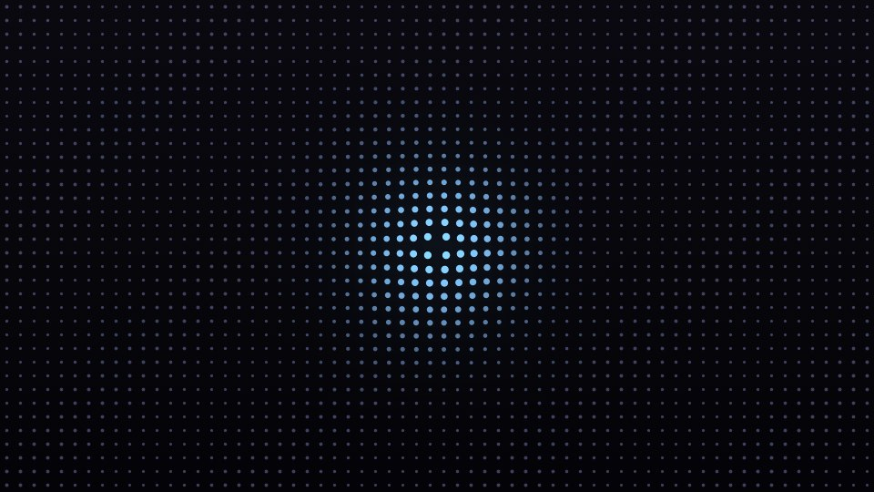

<h1 align="center">livewall</h1>

<p align="center">
  <b>Free, open-source live wallpaper for Windows 10 and 11.</b><br>
  Animated, video, GIF and picture wallpapers behind your desktop icons, using about <b>3 MB</b> of memory.
</p>

<p align="center">
  <a href="https://github.com/manndevani/LiveWallpaper/releases/latest"></a>
  
  
  <a href="LICENSE"></a>
</p>

<p align="center"></p>

## Why livewall

| The numbers | What they mean |
|---|---|
| 🪶 **94 KB** | The whole app is one small file. Nothing to install, nothing extra to download, no account. |
| 🧠 **~3 MB** | Memory while an animated wallpaper is playing. |
| 💤 **0% GPU** | When a window covers the desktop, it stops completely and uses no graphics power. |
| ⚡ **~0.1% CPU** | Barely touches your processor. The graphics card does the work. |
| 🖥️ **Sharp** | Draws at your screen's own resolution. |
| 🆓 **Free forever** | MIT-licensed, no ads, no tracking, no internet access. |

<p align="center"></p>

## Wallpapers

Five animated wallpapers come built in, and they repeat smoothly with no visible jump. *Ripples* and *Glow Grid* react to your mouse.

<table>
  <tr>
    <td><br><b>Aurora</b></td>
    <td><br><b>Dunes</b></td>
  </tr>
  <tr>
    <td><br><b>Night Sky</b></td>
    <td><br><b>Ripples</b> (interactive)</td>
  </tr>
  <tr>
    <td><br><b>Glow Grid</b> (interactive)</td>
    <td><b>Add your own</b><br>🎬 Video wallpapers: mp4, mov, mkv, webm, wmv, avi<br>🖼️ GIF and picture wallpapers: gif, png, jpg, webp…<br>✨ Shader wallpapers: write your own in HLSL (<a href="docs/CUSTOM_SHADERS.md">guide</a>)</td>
  </tr>
</table>

## Settings

<p align="center"></p>

Click a wallpaper to apply it. Adjust speed, brightness, frame rate, resolution and fit. It follows your light/dark theme and accent color.

## Download and run

1. Download the zip from **[Releases](https://github.com/manndevani/LiveWallpaper/releases/latest)**.
2. Unzip it and run `livewall.exe`.
3. Pick a wallpaper. From now on it starts with Windows by itself, quietly, with no window: just a small icon next to the clock.

> Windows may say "Windows protected your PC", because the app isn't code-signed yet. Click **More info → Run anyway**.

## Smart pausing

livewall stops drawing whenever nobody can see it:

- a window or a game covers the screen (maximized and fullscreen apps count),
- the PC is locked or the display is off,
- the laptop is on battery (optional).

After a moment paused, it gives its memory back to Windows (0.3 MB). Still pictures cost nothing: Windows shows them itself.

## FAQ

**Does it slow down games?** No. Fullscreen and maximized apps cover the desktop, so livewall pauses and uses no graphics power.

**Does it work on my graphics card?** Yes, on any graphics card from about 2008 onward: AMD, Intel or NVIDIA. If there is no graphics driver (for example in some virtual machines), it uses the processor instead. So far it's been tested on Intel + NVIDIA; AMD reports are welcome in [Issues](https://github.com/manndevani/LiveWallpaper/issues).

**Laptop with two graphics chips?** It uses the one that drives your screen. Turn on *Use integrated GPU* to save even more power.

**Is there sound?** No. Video wallpapers are always muted.

**Does it send my data anywhere?** No. livewall never connects to the internet.

## Coming next

| Platform | Status |
|---|---|
| Windows 10 / 11 | ✅ Available |
| Linux (KDE, Sway, Hyprland, X11) | 🛠️ Planned |
| macOS | 🛠️ Planned |
| Android | 🛠️ Planned |
| iPhone / iPad | ⚠️ iOS doesn't allow live wallpapers; video/Live Photo export planned |

## Support livewall

livewall is free and always will be. If it makes your desktop nicer:

- ❤️ [Sponsor on GitHub](https://github.com/sponsors/manndevani)
- ☕ [Buy me a coffee](https://buymeacoffee.com/manndevani)
- ⭐ Star this repo and tell a friend

Bug reports, wallpapers, testing on other PCs and help with the Linux, Mac and Android versions are all welcome: see [CONTRIBUTING.md](CONTRIBUTING.md).

---

<details>
<summary><b>Build from source</b></summary>

You need Visual Studio 2022 (or the Build Tools) with **Desktop development with C++**. Then run:

```
build.bat
```

The output is `build\livewall.exe`. Written in plain C on Direct3D 11, with no C runtime. See [ARCHITECTURE.md](docs/ARCHITECTURE.md), [FINDINGS.md](docs/FINDINGS.md) and [STATUS.md](docs/STATUS.md).

| Command | Effect |
|---|---|
| `livewall.exe` | Start the wallpaper (or open settings if it's already running) |
| `livewall.exe -startup` | Start the wallpaper with no window (used when Windows starts) |
| `livewall.exe -settings` | Open the settings window |
| `livewall.exe -add` | Open settings and the file picker |
| `livewall.exe -quit` | Stop the wallpaper |
| `livewall.exe -snapshot <id or file> <out.png> [seconds]` | Render one frame to a PNG |

</details>

<details>
<summary><b>What livewall changes on your PC, and how to uninstall</b></summary>

- **Start with Windows** (on by default) adds a scheduled task named `livewall`.
- Settings are stored in `%APPDATA%\livewall`.
- Choosing a **still picture** sets it as your normal Windows wallpaper.

Nothing else: no registry changes, no services, no drivers.

**To uninstall:**
1. Open the settings and turn off **Start with Windows**.
2. Right-click the tray icon → **Exit**.
3. Delete `livewall.exe` and the `%APPDATA%\livewall` folder.

If it still starts at sign-in, remove the task with:

```
schtasks /Delete /TN livewall /F
```

</details>

## Privacy

livewall does not connect to the internet. It does not transfer any information to other networked systems, and it collects no data.

## Code signing policy

Release builds are made by [GitHub Actions](.github/workflows/build.yml) from the source code in this repository, so anyone can check what went into them. Releases are currently **not code-signed**; signing is planned.

- Committers and reviewers: [Mann Devani](https://github.com/manndevani)
- Approvers: [Mann Devani](https://github.com/manndevani)

## License

MIT: free for everyone to use, change and share. See [LICENSE](LICENSE).

<sub>Keywords: live wallpaper for Windows 11, animated wallpaper for Windows 10, video wallpaper, GIF wallpaper, desktop customization, lightweight live wallpaper, free open-source wallpaper app, shader wallpaper, interactive wallpaper.</sub>
